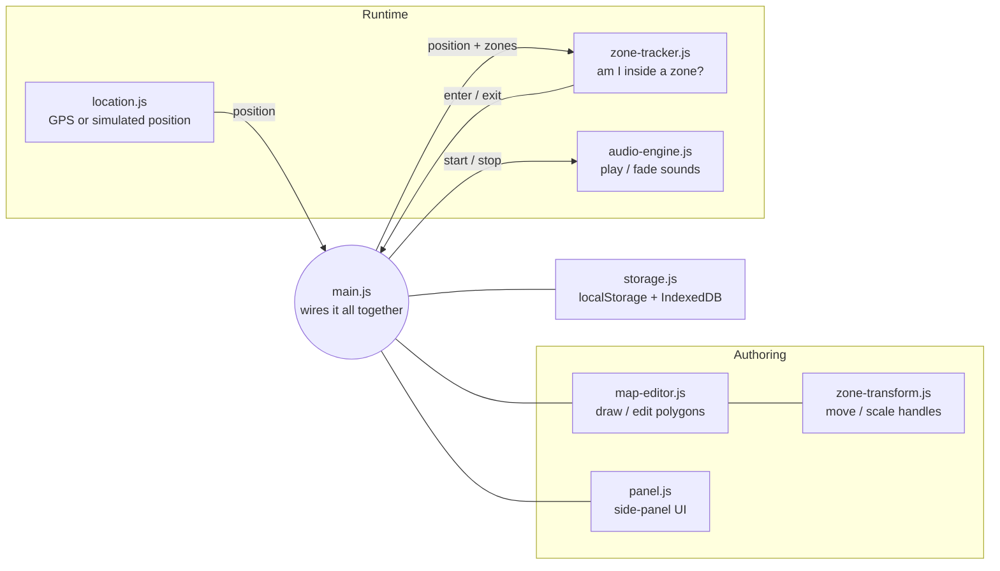

# AudioZones IRL

Game-style audio zones, but in the real world.

You draw zones on a map and give each one a sound. Then you walk around with
your phone: when GPS puts you inside a zone, its sound fades in, and when you
leave, it fades out. It works like ambience zones in a game level, except the
level is your neighbourhood.

For now each zone plays a plain audio file through the browser's Web Audio API.
The long-term plan is to trigger FMOD events instead, and the audio code is
isolated so it can be swapped out (see [Swapping in FMOD](#swapping-in-fmod)).

---

## Using it

1. **Draw a zone.** Use the polygon tool (⬟) on the map. The zone gets a
   default name and opens in the side panel.
2. **Shape it.**
   - Select a zone, then drag the **✥** handle (or the zone itself, on desktop)
     to move it.
   - Drag the **⤡** handle to scale it uniformly.
   - Use Leaflet.Draw's edit tool to move individual vertices.
3. **Give it a sound.** Upload an audio file or paste a URL, then set the
   volume, looping and fade times. **Preview** plays the sound once.
4. **Walk it.**
   - **Simulate**: a pink dot appears on the map. Drag it through your zones to
     test at your desk.
   - **Use GPS**: tracks your real position (blue dot plus an accuracy circle).
5. **Save and share.** Zones save automatically in the browser. Use
   **Export / Import JSON** to move a project between devices.

---

## Testing on your phone (GitHub Pages)

1. **Put the music in the repo.** Copy the files into `audio/`, e.g.
   `audio/forest.mp3`.
2. **Author on the laptop.** For each zone, type the relative URL
   (`audio/forest.mp3`) into the URL box and press **Use**. Don't upload
   the files: uploads only exist in the laptop's browser.
3. **Bake it in.** Press **Export JSON**. This downloads `example.json`;
   move it to the repo root, next to `index.html`.
4. **Publish.** Commit and push, then on GitHub go to *Settings → Pages* and
   set *Deploy from a branch* to `main` / root. The site appears at
   `https://<user>.github.io/<repo>/` after a minute or so.
5. **On the phone.** Open the site. On a first visit it loads `example.json`
   automatically. After you push changes, press **Load bundled example** to
   pick them up, because the phone keeps its own saved copy.
6. **Walk.** Turn the GPS threshold up if fixes keep being ignored. Keep the
   page open: the screen is kept awake while GPS is running, but switching
   apps or locking the phone pauses tracking. On an iPhone older than iOS 17,
   also turn off the silent switch.

Two things to keep in mind:
- A repo published on the free Pages plan is public, and that includes any
  music you put in it.
- Each track is fully decoded into memory, at about 20 MB per minute of
  stereo audio. A few tracks of a few minutes each are fine, but dozens of long
  tracks could strain a phone.

---

## How it works

### The big picture



The app has two halves that share one data model:

- **Authoring** turns the shapes you draw into a list of zones, each carrying
  its sound settings.
- **Runtime** takes a stream of positions, works out which zones contain the
  current position, and turns "entered zone X" / "left zone X" into "fade sound
  X in or out".

`main.js` is the only file that knows about all the others. Every other module
is self-contained and talks to the outside world only through the callbacks
you pass it. That keeps each piece replaceable: a different map library, a
native GPS source, or FMOD instead of Web Audio.

### The data model: zones are GeoJSON

A project is a standard
[GeoJSON](https://geojson.org/) `FeatureCollection`. Each zone is a `Polygon`
feature, and its sound settings live in `properties`:

```json
{
  "type": "Feature",
  "geometry": {
    "type": "Polygon",
    "coordinates": [[[-3.001, 39.999], [-2.999, 39.999], [-2.999, 40.001], [-3.001, 40.001], [-3.001, 39.999]]]
  },
  "properties": {
    "id": "6f1c…",
    "name": "Plaza",
    "type": "audiozone",
    "audio": { "kind": "url", "url": "https://…/plaza.mp3", "name": "plaza.mp3" },
    "volume": 0.8,
    "loop": true,
    "fadeIn": 2,
    "fadeOut": 2
  }
}
```

- Coordinates are `[longitude, latitude]`, which is the GeoJSON convention. Note
  the order: it's the reverse of Leaflet's `[lat, lng]`.
- `audio` is either `{ kind: "url", url, name }` or
  `{ kind: "file", id, name }`. A `file` reference points at an uploaded file
  stored in the browser's IndexedDB under that `id`.
- The defaults for new zones are in `ZONE_DEFAULTS` in `map-editor.js`.

Using GeoJSON means exported projects can be opened in any GIS tool
(geojson.io, QGIS and so on) and the format doesn't need inventing.

### Authoring: drawing and editing zones

**Drawing** uses [Leaflet](https://leafletjs.com/) for the map (with
OpenStreetMap tiles) and [Leaflet.Draw](https://github.com/Leaflet/Leaflet.draw)
for the polygon, vertex-edit and delete tools. Both load from a CDN in
`index.html`.

`map-editor.js` keeps every zone as a Leaflet layer in one `featureGroup`. The
layer itself holds the zone's data: each layer carries its GeoJSON feature on
`layer.feature`, so the map is the single source of truth while editing.
`getZones()` turns the layers back into a fresh `FeatureCollection` whenever
someone needs the current state.

**Moving and scaling** is handled by `zone-transform.js`, because Leaflet.Draw
can only move individual vertices. When a zone is selected, the transform tool
places two draggable markers on it:

- **Move**: every vertex shifts by the same offset as the handle.
- **Scale**: every vertex moves away from (or towards) the zone's centre by the
  ratio `current handle distance ÷ starting handle distance`.

The maths runs in **screen pixels** (Leaflet "layer points"), not in
latitude/longitude. A degree of longitude is shorter than a degree of latitude
everywhere except at the equator, so scaling in degrees would squash or stretch
the shape. Doing it in pixels keeps the shape exactly as it looks on screen.
The handles are hidden while any Leaflet.Draw tool is active so the two don't
fight over the same polygon.

Every change (draw, edit, move, scale, delete, property tweak) calls the
editor's `onChange(zones)` callback. `main.js` uses it to save the project and
to update anything that's currently playing.

### Runtime: where am I?

`location.js` provides two interchangeable **position sources**. Both emit the
same object: `{ lat, lng, accuracy, simulated }`.

| Source | How it works | `accuracy` |
|---|---|---|
| `createGpsSource` | `navigator.geolocation.watchPosition` with `enableHighAccuracy`. Draws a blue dot and an accuracy circle. | Whatever the device reports, in metres |
| `createSimSource` | A draggable pink marker. Emits a position on every drag movement. | `0` (exact) |

Because the rest of the app can't tell the two apart, anything that works in
the simulator works with real GPS, give or take GPS noise.

### Runtime: which zone am I in?

`zone-tracker.js` answers that question.

**Point-in-polygon.** It uses the standard
[ray-casting test](https://en.wikipedia.org/wiki/Point_in_polygon#Ray_casting_algorithm):
draw an imaginary line from the point off to the side and count how many polygon
edges it crosses. An odd count means inside, an even count means outside.
Polygons with holes are supported: the point must be inside the outer ring and
outside every hole. Treating lat/lng as flat x/y is fine at the scale of
walkable zones.

**Hysteresis (dealing with GPS jitter).** A raw GPS position wanders by several
metres even when you're standing still. If you stood near a zone's edge, a
naive "inside? play : stop" would make the sound stutter on and off. The
tracker smooths this out in two ways:

1. **Accuracy gate.** Fixes whose reported error is worse than a threshold
   (default 50 m, adjustable in the Play panel) are ignored completely.
2. **Consecutive-fix counting.** For each zone the tracker remembers whether
   you're `inside` and keeps a `streak` counter.
   - A fix that disagrees with the current state increases the streak.
   - A fix that agrees resets it to zero.
   - The state only flips when the streak reaches **2 fixes to enter** or
     **3 fixes to exit**.

   Exiting is deliberately harder than entering, which biases the system
   towards keeping sound playing near an edge. That usually feels better than
   cutting it off.

The simulator and map edits pass `{ immediate: true }`, which skips both checks.
Simulated positions are exact, and when you move a zone you expect the result
straight away.

When a zone's state flips, the tracker calls `onEnter(feature)` or
`onExit(id)`. It also fires `onExit` for any zone that's deleted while you're
inside it, and for every active zone when tracking stops (`reset()`).

**Overlapping zones** each track their own state, so standing in two zones
plays both sounds layered together.

### Runtime: playing sound

`audio-engine.js` is a small wrapper around the Web Audio API. Each playing
zone is a **voice**:

```
AudioBufferSourceNode ──► GainNode ──► speakers
   (the decoded file)     (volume + fades)
```

- **`start(id, props)`** loads the audio (from IndexedDB or a URL), decodes it
  (decoded buffers are cached, so re-entering a zone is instant), starts it,
  and ramps the gain from 0 up to `volume` over `fadeIn` seconds.
- **`stop(id)`** ramps the gain down to 0 over `fadeOut` seconds and then stops
  the source. Leaving and re-entering a zone mid-fade starts a fresh voice that
  crossfades with the one fading out.
- **`update(id, props)`** applies edits live: volume changes ramp smoothly, and
  swapping the audio file restarts the voice.
- If a zone is exited while its file is still loading, the start is cancelled
  when the load finishes, so you never hear a zone you've already left.

**Mobile audio unlock.** Mobile browsers refuse to play sound until the user
taps something. `engine.unlock()` creates and resumes the `AudioContext`, and
it's called synchronously inside the click handlers of **Simulate**, **Use
GPS** and **Preview**. That tap is what allows audio for the rest of the
session.

### Storage

`storage.js` keeps two kinds of data:

| What | Where | Why |
|---|---|---|
| The zones `FeatureCollection` | `localStorage` (`audiozones.zones.v1`) | Small JSON, saved on every change |
| Settings (GPS accuracy threshold) | `localStorage` (`audiozones.settings.v1`) | Same |
| Uploaded audio files | IndexedDB (`audiozones` → `audio`) | Audio files are too big for `localStorage`, and IndexedDB stores `Blob`s natively |

Export/Import JSON saves and loads the zones only. Uploaded files stay in the
browser that uploaded them, so zones that use **URLs** are the portable ones.

---

## How the files relate

```
index.html            Page layout: map container + side panel markup. Loads Leaflet,
                      Leaflet.Draw and js/main.js.
styles.css            All styling, including the phone layout (panel moves below the
                      map under 760px) and the player dot / handle styles.

js/
  main.js             The conductor. Creates every module, connects their callbacks,
                      owns app state (current zones, mode, last position).
  map-editor.js       Leaflet map + Leaflet.Draw. Creating, selecting, editing and
                      styling zones. Converts layers ⇄ GeoJSON.
  zone-transform.js   Move / uniform-scale handles for the selected zone.
                      Used only by map-editor.js.
  panel.js            Side panel DOM: mode buttons, status, zone list, zone editor,
                      import/export. Reports user actions back as callbacks.
  location.js         Position sources: real GPS and the draggable simulator.
  zone-tracker.js     Point-in-polygon + hysteresis → enter / exit events.
  audio-engine.js     Web Audio voices with fades. The piece FMOD would replace.
  storage.js          localStorage (zones, settings), IndexedDB (audio files),
                      JSON download / upload helpers.
```

### Dependencies between modules

```
main.js
 ├── map-editor.js ── zone-transform.js
 ├── panel.js
 ├── location.js
 ├── zone-tracker.js
 ├── audio-engine.js
 └── storage.js
```

Only `main.js` imports more than one module, and the modules never import each
other. The one exception is `map-editor.js` using `zone-transform.js` as an
internal helper. Communication goes through callbacks that `main.js` passes in.

### Walkthrough: what happens when you walk into a zone

1. `location.js` gets a GPS fix and calls `onPosition({ lat, lng, accuracy })`.
2. `main.js` (`handlePosition`) passes it to `tracker.update(position, zones)`.
3. `zone-tracker.js` ignores the fix if `accuracy` is too poor. Otherwise it
   ray-casts the position against every zone. This is the second "inside" fix
   in a row for *Plaza*, so it flips Plaza to inside and calls `onEnter(Plaza)`.
4. `main.js` calls `engine.start(Plaza.id, Plaza.properties)` and refreshes the
   UI: the zone turns blue on the map and shows "▶ playing" in the list.
5. `audio-engine.js` loads and decodes `plaza.mp3` (or takes it from the cache)
   and fades it in over `fadeIn` seconds.

Leaving runs the same path in reverse: three "outside" fixes in a row →
`onExit(id)` → `engine.stop(id)` → fade out.

### Walkthrough: what happens when you edit a zone

1. You move the zone, or change its volume in the panel.
2. `map-editor.js` updates the layer and calls `onChange(zones)`.
3. `main.js`:
   - saves the project to `localStorage`
   - calls `engine.update()` on every playing voice, so volume and audio
     changes are heard immediately
   - re-runs `tracker.update(lastPosition, zones, { immediate: true })`, so if
     the zone moved onto or off you, its sound starts or stops straight away
   - re-renders the zone list.

---

## Swapping in FMOD

The rest of the app only talks to the audio engine through this interface:

```js
engine.unlock()               // from a user gesture
engine.start(id, props)       // zone entered
engine.stop(id, fadeOut?)     // zone exited
engine.update(id, props)      // zone edited while playing
engine.stopAll(fadeOut?)
engine.isPlaying(id)
```

An FMOD version (for example FMOD's HTML5/WASM build, or a native app) would
implement the same functions. `start` would create and start an event instance
named by something like `props.fmodEvent`, and `stop` would stop it with
`FMOD_STUDIO_STOP_ALLOWFADEOUT`, letting the FMOD event handle its own fades.
Nothing else in the app would need to change. Distance from a zone's edge or
centre would be a natural extra value to feed into an FMOD parameter.

---

## Known limitations

- **Screen lock / background.** Browsers pause GPS when the phone screen locks
  or the tab goes to the background. Reliable background tracking would need a
  native app (which is also where FMOD fits best).
- **GPS accuracy.** Expect ±3–15 m outdoors in the open, and much worse indoors
  or among tall buildings. Zones smaller than about 20 m across will feel
  unreliable.
- **Uploaded audio isn't portable.** Files live in that browser's IndexedDB.
  Use URLs for projects you want to move between devices.
- **Audio URLs need CORS.** The server hosting the file must allow cross-origin
  requests, or the browser won't let the page decode it.
- **Orphaned files.** Deleting a zone with Leaflet.Draw's trash tool doesn't
  remove its uploaded audio from IndexedDB (the panel's **Delete zone** button
  does).
- **Polygons only.** Imported `MultiPolygon` or other geometry types are skipped.
